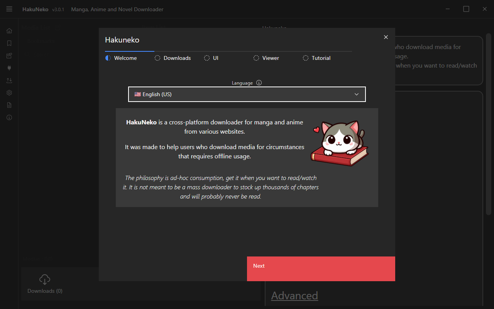
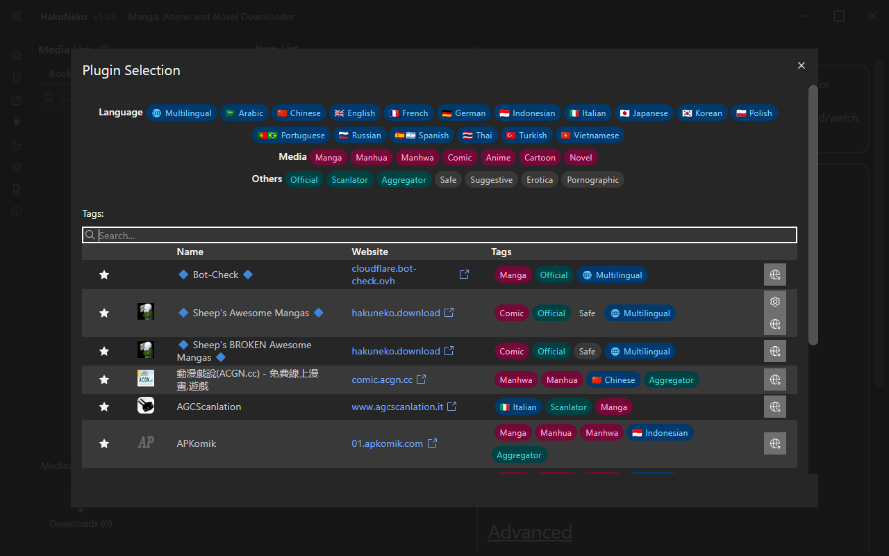
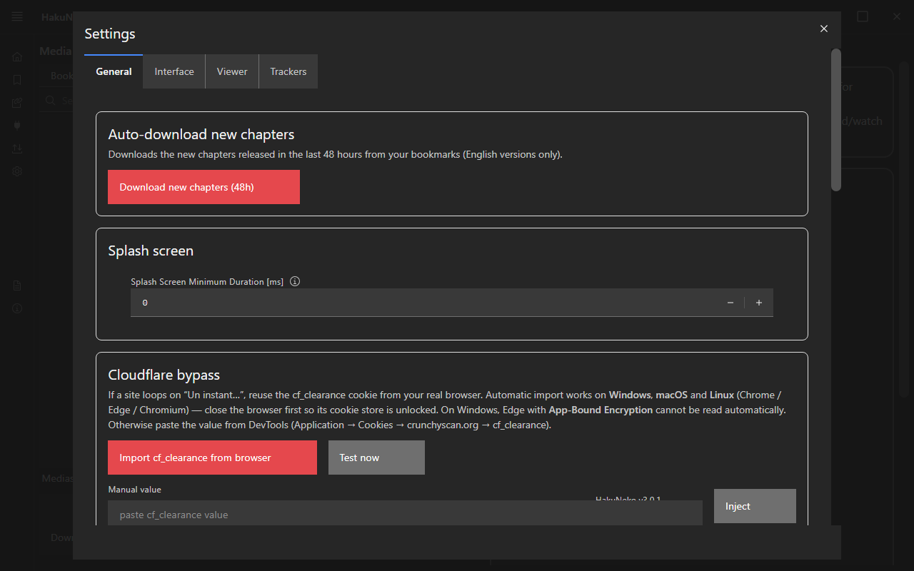

# ChainsmokerNeko 🚬🐱

[](https://github.com/Endymi0n74/ChainsmokerNeko/actions/workflows/push-ci.yml)


An autonomous fork of [HaruNeko](https://github.com/manga-download/haruneko) (formerly
HakuNeko): a desktop downloader for manga, anime and novels.

The **`3.0.x`** product line lives on the `chainsmoker` branch; `master` stays a pristine
mirror of upstream. CI builds the three-OS bundles on every tag, and an installed app
updates itself from the releases.

🇫🇷 [Français](README.md) · 🇬🇧 English

## 📥 Download

👉 **[Latest release](https://github.com/Endymi0n74/ChainsmokerNeko/releases/latest)**

| Platform | Packages | Status |
|---|---|---|
| Windows 10/11 x64 · ia32 · arm64 | portable `.zip` or `setup.exe` (NSIS) | validated |
| Linux x64 | `.AppImage`, `.deb` (amd64) | untested |
| macOS x64 · arm64 | `.dmg` | untested |

Every release ships ten artifacts. Only the Windows packages are validated in real use:
the Linux and macOS builds are produced by CI but have not been exercised — their file
names carry `.untested` so this stays visible.

## 📸 Screenshots





> Screenshots are regenerated with `node scripts/take-screenshots.mjs` (launches the
> Electron app against a local `vite preview` server).

## ✨ What this fork adds

- **Cloudflare suite** (the differentiator): window shown only when a challenge widget
  is actually rendered, reload poller for "managed" challenges, `cf_clearance` persisted
  across restarts, cookie import from Chrome/Edge (v10/v20 decryption + DPAPI), and a
  "Clear Cloudflare cache" button in the settings.
- **Connectors kept alive after upstream drops them**: CrunchyScan, YaoiScanFR and
  HentaiScantrad.
- **MangaDrama**: in-app account login, coin price shown on locked chapters, purchased
  chapters unlocked.
- **MangaFire / Comix**: working catalogue and reader, DRM-free.
- **Downloads**: PDF / CBZ / omnibus exports, download timeouts (15 s stall, task
  watchdog), progress shown as soon as a task starts.
- **Bilingual releases**: `CHANGELOG.md` / `CHANGELOG.en.md`, versions kept aligned
  across the three manifests and enforced by CI.

## 🔧 Development

Node.js 24 is required.

```bash
npm ci
npm run build:web
npm run build --workspace=app/electron
./node_modules/electron/dist/electron.exe ./app/electron/build
```

Other useful commands:

```bash
npm run check        # manifest versions + typecheck/lint for every workspace
npm test             # unit suites (web, Electron, NW)
npm run bundle:x64   # local Windows x64 bundle
```

## 📚 Documentation

- [CHANGELOG.en.md](CHANGELOG.en.md) · [CHANGELOG.md](CHANGELOG.md) — release notes
  (every published version must be documented there; CI checks it).
- [SYNC.md](SYNC.md) — branch policy and upstream merge procedure.
- [ROADMAP.md](ROADMAP.md) — scope and vision.
- [CONTRIBUTING.md](CONTRIBUTING.md) · [SECURITY.md](SECURITY.md).

## 📄 License

[Unlicense](UNLICENSE) — public domain.

---

*Built with vibe coding using [Codebuff](https://codebuff.com).*
